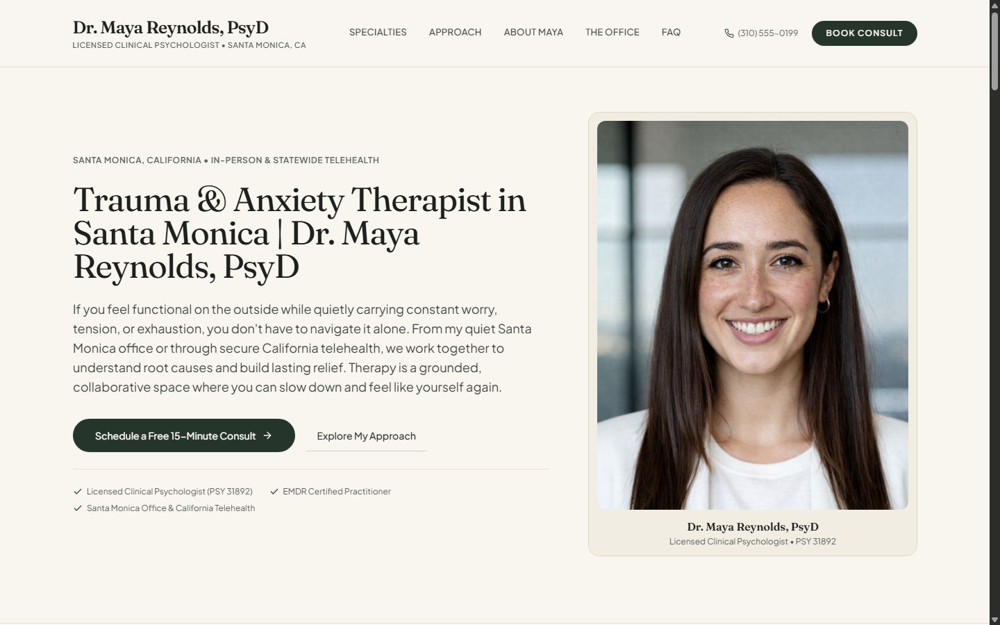
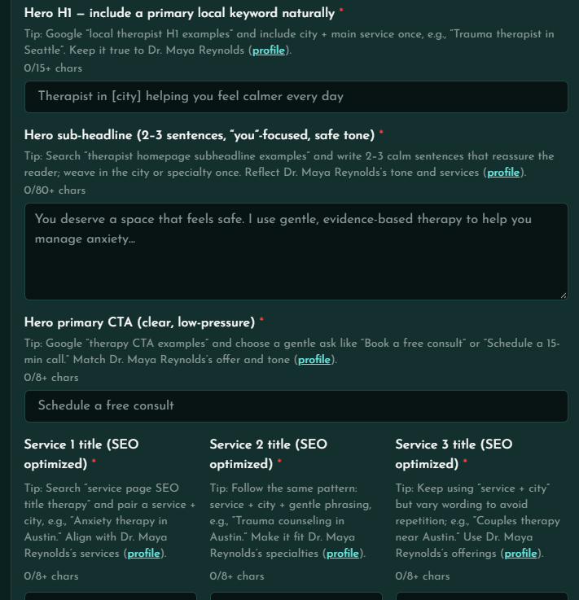
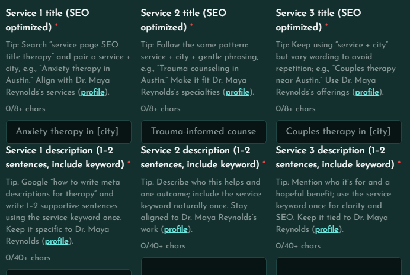
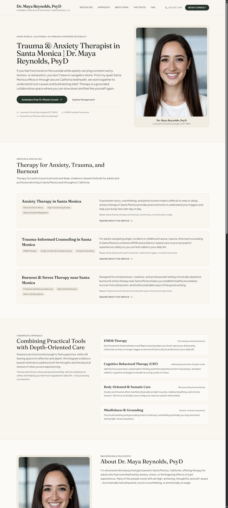

# Dr. Maya Reynolds, PsyD — Santa Monica Clinical Practice Website

An authentic, human-crafted web application for **Dr. Maya Reynolds, PsyD**, a Licensed Clinical Psychologist based in Santa Monica, California, offering in-person psychotherapy and statewide California telehealth.

Built with **React 18**, **Vite**, and **Tailwind CSS**, designed with an editorial aesthetic in favor of grounded, compassionate, and clinically sound communication.



---

## 1. Practice Overview

- **Clinician**: Dr. Maya Reynolds, PsyD
- **Licensure**: Licensed Clinical Psychologist (PSY 31892)
- **Office Location**: 123th Street 45 W, Santa Monica, CA 90401
- **Service Modality**: In-person Santa Monica sessions & statewide California telehealth
- **Specialties**: Anxiety & Panic, Single-Incident & Complex Trauma (EMDR), Professional Burnout & Perfectionism
- **Approach**: Integrative, blending Cognitive Behavioral Therapy (CBT), EMDR, somatic nervous system regulation, and mindfulness practices

---

## 2. Local SEO & Copywriting Architecture

Every heading, sub-headline, and service description has been precision-crafted to rank locally for Santa Monica psychology queries while maintaining an empathetic, low-pressure tone:

### Form Inputs & Assessment Screenshots

| Hero & Subhead Prompt Requirements | Featured Services Prompt Requirements |
|---|---|
|  |  |

### Hero Section Copy
- **Hero H1 (Primary Local Keyword)**:
  > **Trauma & Anxiety Therapist in Santa Monica | Dr. Maya Reynolds, PsyD**
  *(68 characters — satisfies 15+ chars requirement)*
- **Hero Sub-Headline (2–3 Calm, "You"-Focused Sentences)**:
  > *If you feel functional on the outside while quietly carrying constant worry, tension, or exhaustion, you don't have to navigate it alone. From my quiet Santa Monica office or through secure California telehealth, we work together to understand root causes and build lasting relief. Therapy is a grounded, collaborative space where you can slow down and feel like yourself again.*
  *(387 characters — satisfies 80+ chars requirement)*
- **Primary CTA (Low-Pressure)**:
  > **Schedule a Free 15-Minute Consult**
  *(35 characters — satisfies 8+ chars requirement)*
- **Secondary CTA**:
  > **Explore My Approach**

---

### Featured Clinical Services (SEO Optimized)

1. **Anxiety Therapy in Santa Monica** *(32 chars)*
   - *Description*: If persistent worry, overthinking, and perfectionism make it difficult to relax or sleep, anxiety therapy in Santa Monica provides practical tools to understand your triggers and help your body feel calm day to day.
   - *Audience*: Adults feeling mentally overwhelmed, overthinking, or emotionally on edge.

2. **Trauma-Informed Counseling in Santa Monica** *(41 chars)*
   - *Description*: For adults navigating single-incident or childhood trauma, trauma-informed counseling in Santa Monica combines EMDR and evidence-based care to process painful experiences safely so you can feel stable in your daily life.
   - *Audience*: Adults dealing with painful memories, relationship triggers, or emotional wounds.

3. **Burnout & Stress Therapy near Santa Monica** *(42 chars)*
   - *Description*: Designed for entrepreneurs, creatives, and professionals feeling chronically depleted, burnout & stress therapy near Santa Monica helps you establish healthy boundaries, recover from exhaustion, and build sustainable ways of living and working.
   - *Audience*: Professionals who feel disconnected after years of pushing through stress.

---

## 3. Human-Centered Editorial Design Philosophy

To ensure the practice feels authentic, warm, and credible, the site utilizes an artisanal editorial approach:

- **Bespoke Editorial Typography**:
  - Headings: **`Fraunces`** (a warm, humanist variable serif with calligraphic warmth) paired with **`Newsreader`** italics.
  - Body & UI: **`Plus Jakarta Sans`** for crisp, comfortable readability.
- **Natural Paper & Earth Color Palette**:
  - Warm unbleached paper/linen backgrounds (`#F9F6F0`, `#F2EDE3`)
  - Deep peat charcoal ink (`#1D211E`) for high-contrast accessibility (WCAG AA compliant)
  - Muted laurel sage (`#4F6653`) and sunbaked terracotta (`#B86249`)
- **Artisanal & Clinical Detail**:
  - Dr. Reynolds's portrait is presented cleanly with her clinical licensure.
  - High-resolution, real interior photography of the Santa Monica office suite and consultation room.
  - Clear logistics: accessible street parking, natural light, secure telehealth, and PPO insurance superbills.

---

## 4. Key Features & Full Page Preview

- **Smooth Landing & Scroll-Triggered Transitions**:
  - Gentle staggered reveal on initial page load (hero elements settle in sequence: 100ms – 600ms).
  - Scroll-triggered reveal animations via a lightweight `IntersectionObserver` wrapper (`FadeIn.jsx`).
  - Full support for `prefers-reduced-motion` for accessibility.
- **Office Sanctuary Gallery**:
  - Real interior photography of the 123th Street therapy space in Santa Monica.
  - Clear logistics on parking, natural light, California telehealth, and PPO insurance superbills.
- **Interactive Consultation Booking Modal**:
  - Low-friction inquiry form for the free 15-minute call.
  - Selection between Santa Monica in-person office and California telehealth.
  - Confidentiality assurances and immediate confirmation screen.
- **Local SEO & Schema Markup**:
  - Embedded JSON-LD structured data (`Physician` and `LocalBusiness`) in `index.html` with exact Santa Monica coordinates, address, and specialty taxonomy.

### Full Website Preview



---

## 5. Project Directory Structure

```text
GrowMyTherapy/
├── public/
│   ├── favicon.svg
│   └── images/
│       ├── dr-maya-reynolds.png       # Official portrait from Google Drive
│       ├── santa-monica-office-1.jpg  # Office Suite from Drive folder
│       └── santa-monica-office-2.jpg  # Consultation Room from Drive folder
├── screenshots/                       # Documentation screenshots

│   ├── assessment-form-hero.png
│   ├── assessment-form-services.png
│   ├── homepage-hero.png
│   └── homepage-full.png
├── src/
│   ├── components/
│   │   ├── common/
│   │   │   ├── Button.jsx
│   │   │   ├── Container.jsx
│   │   │   ├── FadeIn.jsx             # IntersectionObserver smooth reveal
│   │   │   └── SectionHeading.jsx
│   │   ├── home/
│   │   │   ├── AboutPreview.jsx       # Complete clinical biography
│   │   │   ├── ApproachSection.jsx    # CBT, EMDR, Somatics, Mindfulness
│   │   │   ├── ConsultationCTA.jsx    # Footer booking banner
│   │   │   ├── ConsultationModal.jsx  # Interactive consultation form
│   │   │   ├── Hero.jsx               # SEO H1, subhead & CTA
│   │   │   ├── PracticeDetails.jsx    # Office gallery & logistics
│   │   │   ├── ServicesGrid.jsx       # 3 SEO clinical services
│   │   │   └── TestimonialsFAQ.jsx    # Client FAQs accordion
│   │   └── layout/
│   │       ├── Footer.jsx             # Practice info & crisis hotline
│   │       └── Header.jsx             # Masthead wordmark & navigation
│   ├── data/
│   │   └── therapyData.js             # Centralized profile, SEO copy & modalities
│   ├── App.jsx
│   ├── index.css
│   └── main.jsx
├── index.html                         # SEO meta tags, Google Fonts, JSON-LD Schema
├── package.json
├── tailwind.config.js
└── vite.config.js
```

---

## 6. Getting Started

### Prerequisites
- Node.js (v18.0.0 or higher recommended)
- npm (v9.0.0 or higher)

### Installation
Clone or navigate to the project directory and install dependencies:
```bash
npm install
```

### Development Server
Run the local development server with hot-module replacement (HMR):
```bash
npm run dev
```
Open your browser at `http://localhost:5173`.

### Production Build
Compile and bundle the application for production:
```bash
npm run build
```
Preview the production build locally:
```bash
npm run preview
```

---

## 7. Version History & Commit Stages

| Commit | Description |
|---|---|
| `5f36275` | `feat(scaffold): initialize Vite React app with Tailwind theme and therapy data` |
| `405aecf` | `feat(ui): add layout, header, footer, and common UI design components` |
| `2d7d537` | `feat(homepage): implement Hero, SEO ServicesGrid, Approach, FAQ, and Consultation modal` |
| `3975d8c` | `style: implement bespoke editorial typography and authentic clinical layout` |
| `7c9d813` | `feat(profile): integrate portrait of Maya, Santa Monica office images, and complete bio` |
| `77fa6d4` | `design: handcrafted editorial aesthetic with Fraunces typography and organic layout` |
| `4ed2e49` | `feat(transitions): implement smooth landing fade-in and scroll-triggered reveal transitions` |
| `d0f957f` | `chore: store images in pictures folder and organize profile assets` |
| `03c7b98` | `refactor: refine tone and layout in favor of authentic human clinical communication` |
| `623980d` | `docs(readme): embed homepage hero, full page, and form input screenshots` |

---

## 8. License & Medical Disclaimer

© Dr. Maya Reynolds, PsyD. All rights reserved.

*Medical Notice: This web application is for informational and educational purposes only and does not establish a doctor-patient relationship. If you are experiencing a mental health emergency, please dial 911 or call/text the 988 Suicide & Crisis Lifeline.*
